<picture>
  <source media="(prefers-color-scheme: dark)" srcset="https://raw.githubusercontent.com/theuslpszbr15/theuslpszbr15/gitascii/profiles/default/dark.svg">
  <source media="(prefers-color-scheme: light)" srcset="https://raw.githubusercontent.com/theuslpszbr15/theuslpszbr15/gitascii/profiles/default/light.svg">
  
</picture>

  <a href="https://github.com/theuslpszbr15/dynamic-island-windows">Dynamic Island</a> ·
  <a href="https://github.com/theuslpszbr15/Nitro">Nitro</a> ·
  <a href="https://github.com/theuslpszbr15/controle-pessoal">Controle Pessoal</a> ·
  <a href="https://github.com/theuslpszbr15/seraph">SERAPH</a>

